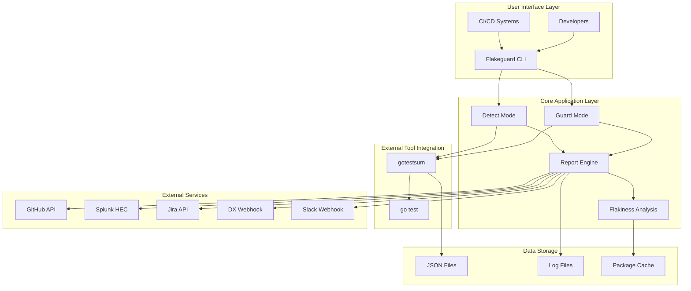
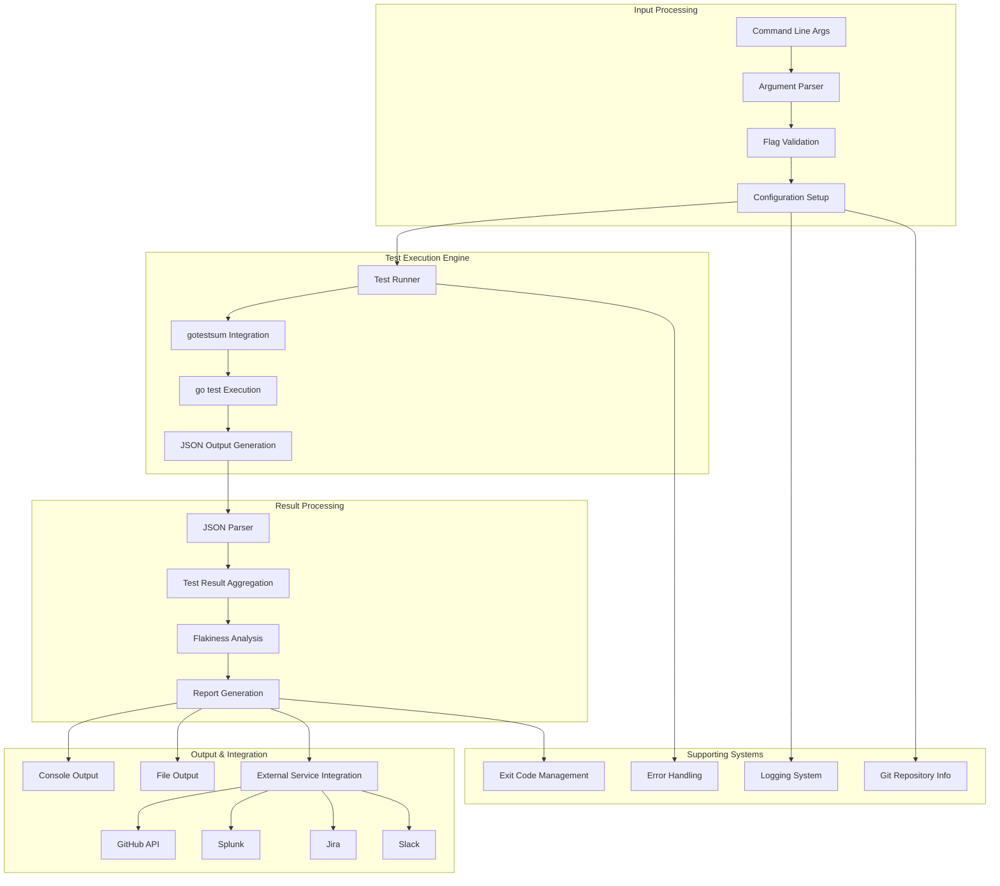
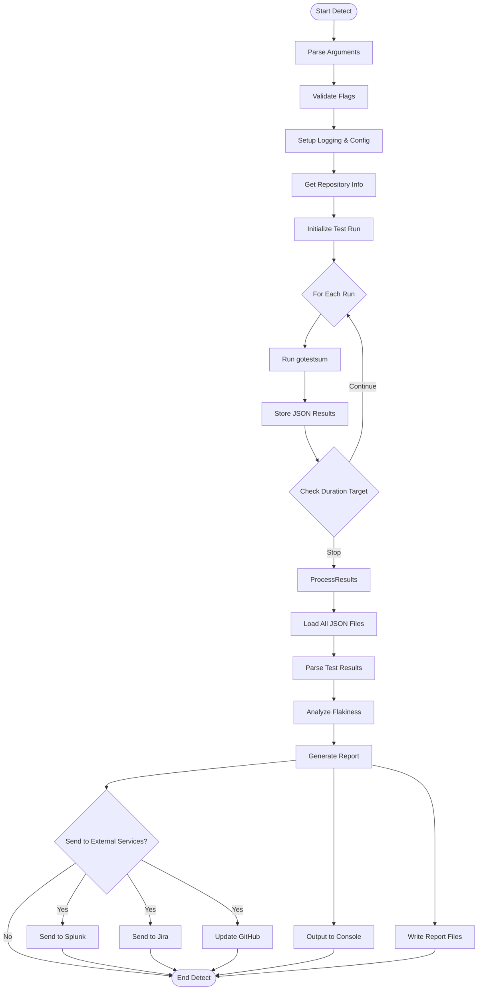
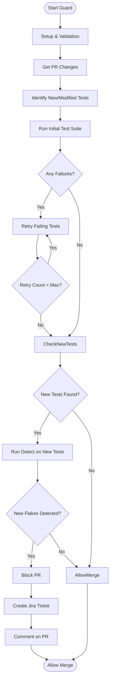
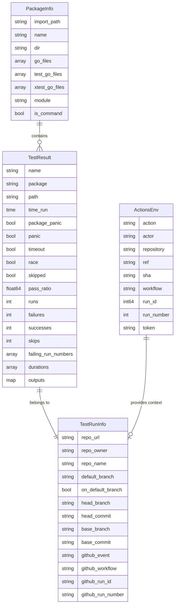
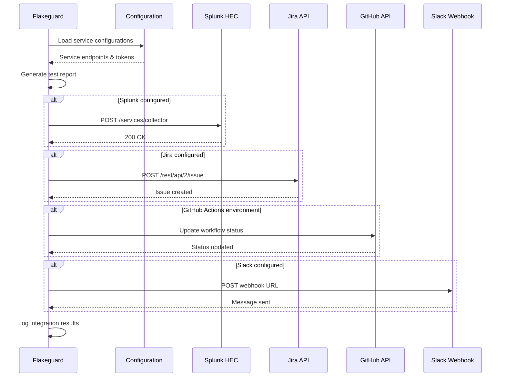
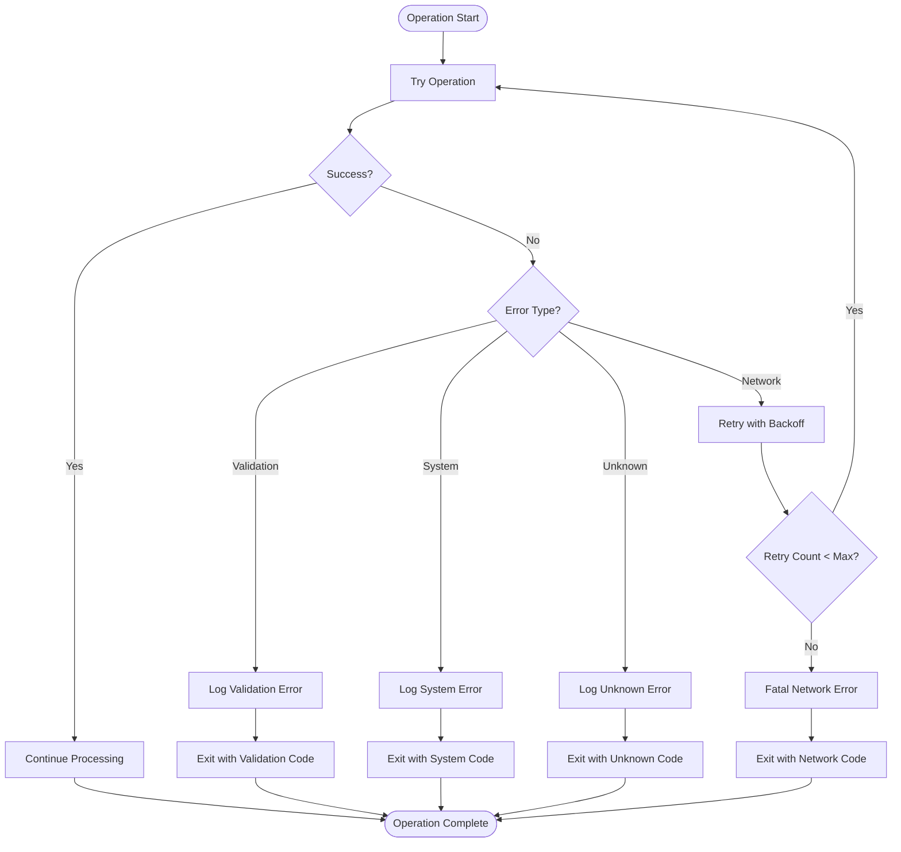
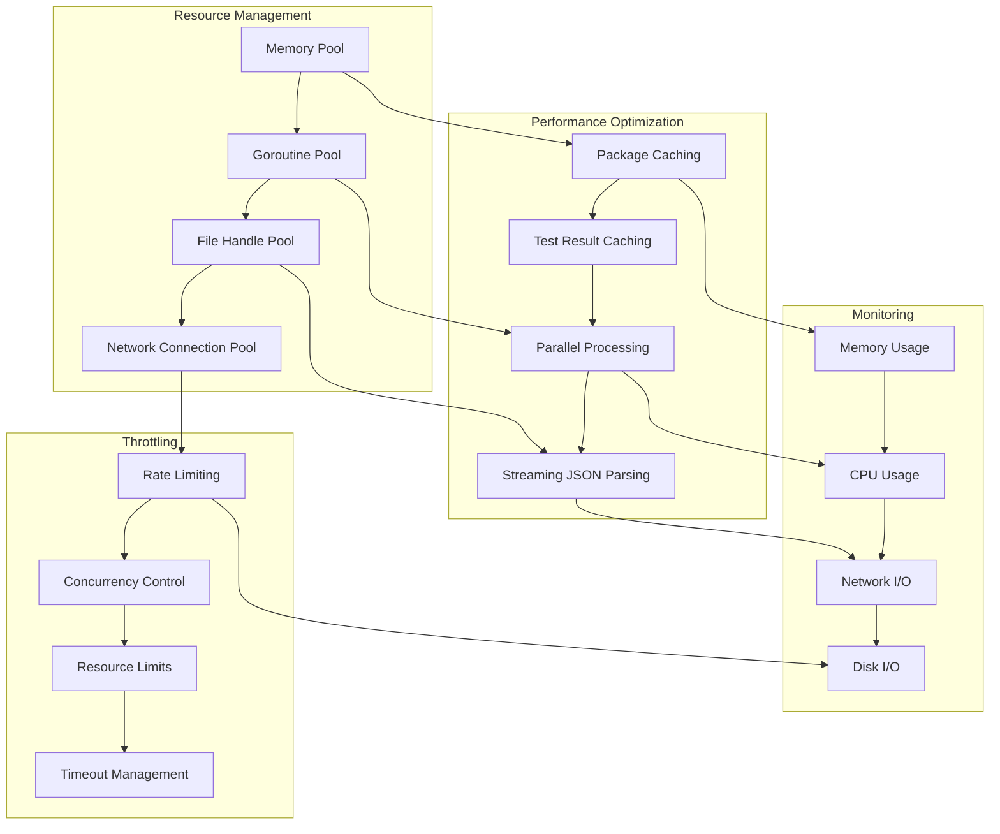
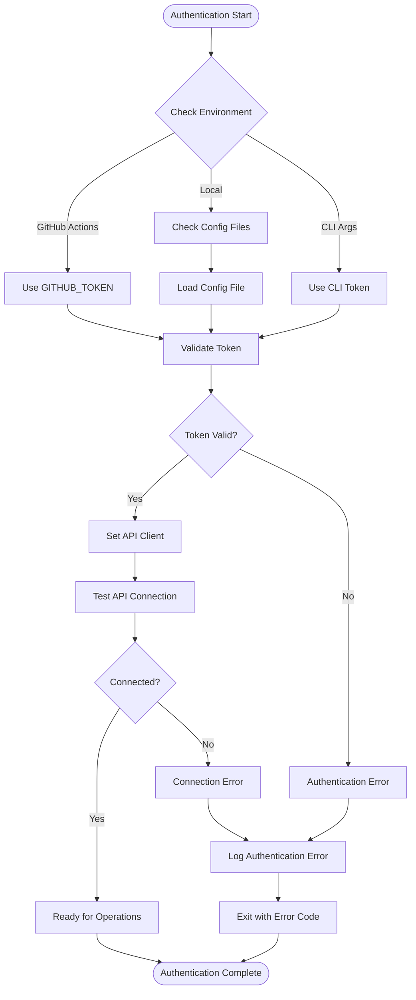

# Flakeguard Architecture Diagrams

## 1. High-Level System Architecture

## 2. Detailed Component Dataflow

## 3. Detect Mode Detailed Flow

## 4. Guard Mode Flow (Planned)

## 5. Data Structures and Relationships

## 6. External Service Integration Flow

## 7. Error Handling and Recovery Flow

## 8. Performance and Resource Management

## 9. Security and Authentication Flow

---

*These diagrams provide detailed visual representations of Flakeguard's architecture, dataflow, and system interactions. They complement the comprehensive documentation and help understand the system's complexity and design decisions.* 