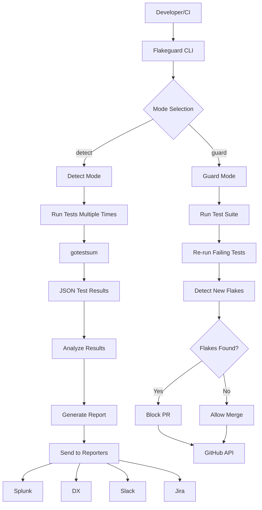
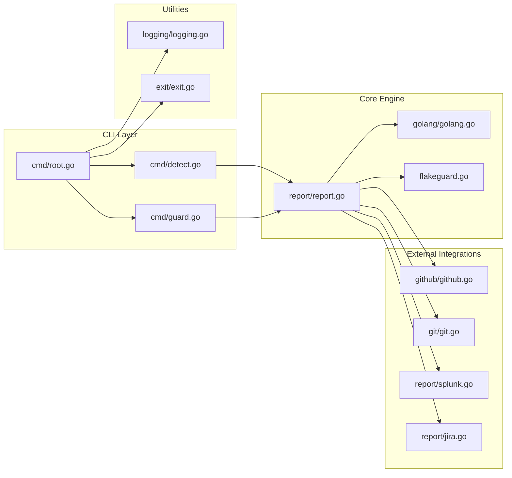
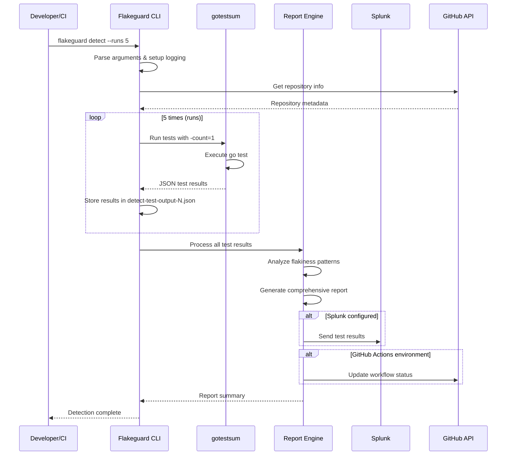
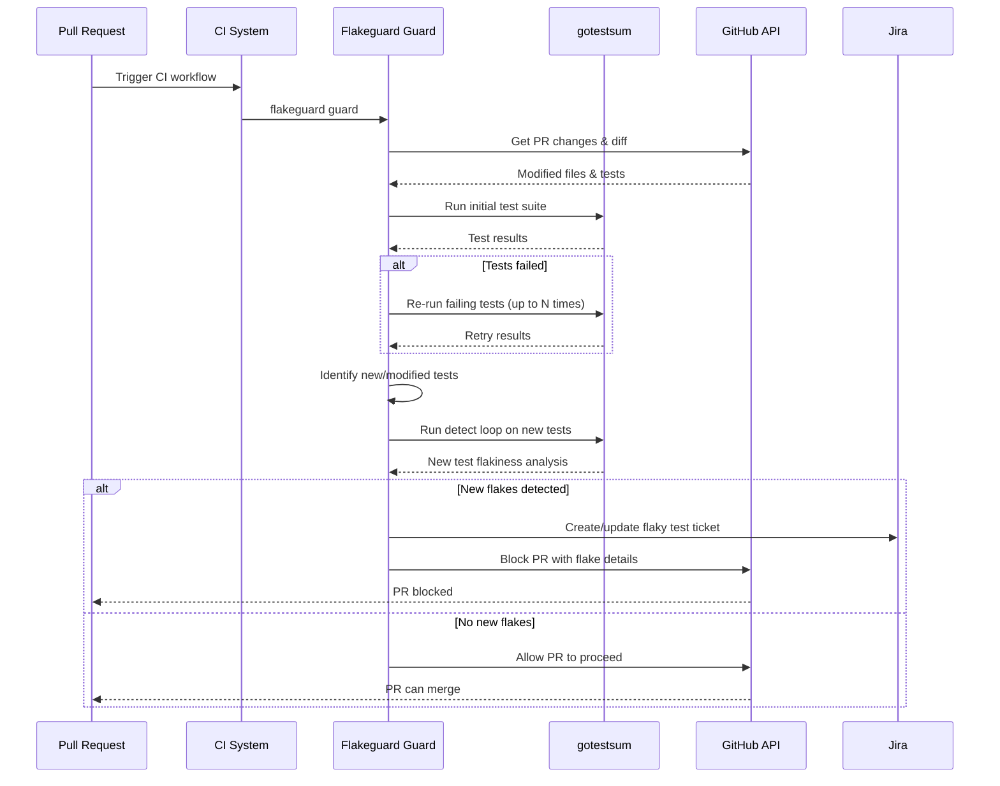
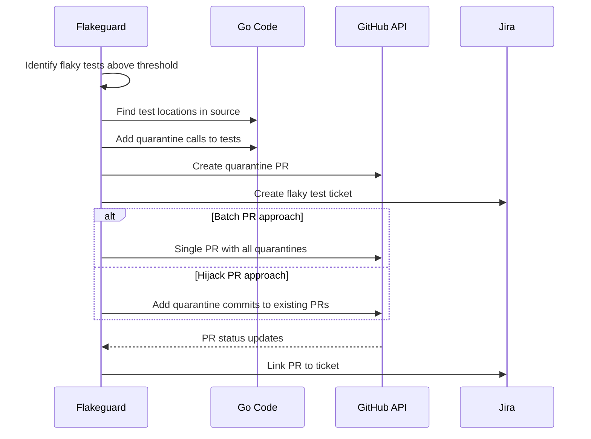

# Flakeguard - Comprehensive Documentation

## Table of Contents
1. [Overview](#overview)
2. [Architecture & Dataflow](#architecture--dataflow)
3. [Sequence Diagrams](#sequence-diagrams)
4. [Key Components](#key-components)
5. [Notable Aspects](#notable-aspects)
6. [Areas for Criticism](#areas-for-criticism)
7. [Getting Started](#getting-started)

## Overview

**Flakeguard** is a Go-based tool designed to detect, quarantine, and prevent flaky tests from disrupting CI/CD pipelines. It operates in two primary modes:

- **`detect`**: Runs tests multiple times to identify flaky tests (best used in nightly cron jobs)
- **`guard`**: Protects CI pipelines by retrying failing tests and detecting newly introduced flakes

### Core Philosophy
Flakeguard aims to be a drop-in replacement for `go test` that automatically handles flaky test detection and quarantine without requiring significant CI restructuring.

## Architecture & Dataflow

### High-Level Architecture Flowchart



### Component Architecture



## Sequence Diagrams

### Detect Mode Sequence



### Guard Mode Sequence



### Quarantine Process Sequence



## Key Components

### 1. Command Layer (`cmd/`)
- **`root.go`**: Main CLI setup, flag parsing, logging configuration
- **`detect.go`**: Implements flaky test detection by running tests multiple times
- **`guard.go`**: Implements CI protection (currently not implemented)

### 2. Core Engine
- **`report/report.go`**: Processes test results, analyzes flakiness, generates reports
- **`golang/golang.go`**: Go code analysis, test location finding, quarantine management
- **`flakeguard.go`**: Core quarantine functionality for tests

### 3. External Integrations
- **`github/github.go`**: GitHub API integration, Actions environment detection
- **`git/git.go`**: Git repository information extraction
- **`report/splunk.go`**: Splunk reporting integration
- **`report/jira.go`**: Jira ticket management

### 4. Utilities
- **`logging/logging.go`**: Structured logging with zerolog
- **`exit/exit.go`**: Exit code management

## Notable Aspects

### Strengths

1. **Comprehensive Test Analysis**: Uses gotestsum for robust test execution and JSON output parsing
2. **Multiple Reporting Options**: Supports Splunk, DX, Slack, and Jira integrations
3. **GitHub Actions Integration**: Native support for GitHub Actions environment
4. **Flexible Configuration**: Extensive CLI options for different use cases
5. **Example Test Suite**: Comprehensive examples for testing and demonstration
6. **Well-Documented**: Extensive documentation including design docs and developer guides

### Technical Highlights

1. **Stateless Design**: Designed to be stateless and scalable
2. **JSON-Based Processing**: Uses structured JSON for test result analysis
3. **Caching Prevention**: Forces `-count=1` to prevent test result caching during detection
4. **Parallel Test Support**: Handles parallel test execution properly
5. **Package-Level Analysis**: Can analyze entire packages for flakiness patterns

### Integration Points

1. **gotestsum**: Leverages gotestsum's JSON output format and test execution capabilities
2. **GitHub API**: Full integration with GitHub for PR management and repository information
3. **External Services**: Modular reporting system supporting multiple destinations
4. **Go Toolchain**: Deep integration with Go's testing framework

## Areas for Criticism

### 1. **Incomplete Implementation**
- **Guard mode is not implemented**: The `guard` command returns "not implemented" error
- **Quarantine functionality incomplete**: `QuarantineTest()` function is a TODO
- **Missing core features**: Many planned features are still in development

### 2. **Architecture Concerns**
- **Tight coupling with gotestsum**: Heavy dependency on external tool limits flexibility
- **Complex CLI structure**: Argument parsing between flakeguard, gotestsum, and go test is complex
- **No plugin system**: Limited extensibility for custom reporting or analysis

### 3. **Performance Considerations**
- **Multiple test runs**: Running tests N times can significantly increase CI duration
- **No caching strategy**: No intelligent caching of previous results
- **Resource intensive**: Multiple parallel test executions can be resource-heavy

### 4. **User Experience Issues**
- **Complex setup**: Requires understanding of multiple tools and configurations
- **Limited feedback**: Minimal real-time feedback during long-running operations
- **Error handling**: Some error scenarios may not be handled gracefully

### 5. **Testing and Reliability**
- **Self-testing challenges**: Testing a flaky test detector is inherently difficult
- **Limited test coverage**: Some components lack comprehensive tests
- **Integration testing**: Complex integration scenarios may not be fully tested

### 6. **Operational Concerns**
- **Quarantine strategy**: Two competing approaches (batch vs. hijack PRs) without clear guidance
- **Threshold management**: No clear strategy for setting flakiness thresholds
- **False positives**: Risk of incorrectly identifying tests as flaky

### 7. **Scalability Issues**
- **Single-threaded analysis**: Test result processing is not parallelized
- **Memory usage**: Loading all test results into memory may not scale
- **Network dependencies**: Heavy reliance on external APIs for core functionality

## Getting Started

### Prerequisites
- Go 1.24.4+
- gotestsum (automatically managed via go.mod)
- GitHub token (for GitHub integration)

### Quick Start
```bash
# Build the project
make build

# Run flaky test detection
./dist/flakeguard detect --runs 5 -- ./pkg/...

# Run with custom gotestsum flags
./dist/flakeguard detect --runs 10 -- --format dots -- -v ./pkg/...
```

### Configuration
```bash
# Basic detection with reporting
flakeguard detect \
  --runs 5 \
  --splunk-url "https://your-splunk.com" \
  --splunk-token "your-token" \
  --github-token "your-github-token" \
  -- ./pkg/...
```

### Integration with CI
```yaml
# GitHub Actions example
- name: Run Flakeguard
  uses: actions/setup-go@v4
  with:
    go-version: '1.24'
  
- name: Detect Flaky Tests
  run: |
    go install github.com/smartcontractkit/flakeguard@latest
    flakeguard detect --runs 5 -- ./...
  env:
    GITHUB_TOKEN: ${{ secrets.GITHUB_TOKEN }}
```

---

*This documentation provides a comprehensive overview of the Flakeguard repository. For detailed technical specifications, refer to the individual component documentation and the design documents in the repository.* 