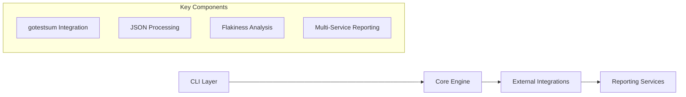

# Flakeguard Repository Analysis Summary

## Executive Summary

Flakeguard is an ambitious Go-based tool designed to detect, quarantine, and prevent flaky tests from disrupting CI/CD pipelines. While the project has a solid foundation and comprehensive documentation, it suffers from incomplete implementation and several architectural concerns that need addressing.

## Key Findings

### ✅ **Strengths**

1. **Excellent Documentation**: Comprehensive design docs, developer guides, and example test suites
2. **Well-Structured Architecture**: Clear separation of concerns with modular components
3. **Multiple Integration Points**: Support for Splunk, Jira, GitHub, Slack, and DX
4. **GitHub Actions Native**: Deep integration with GitHub Actions environment
5. **Comprehensive Example Suite**: Extensive test examples covering various flaky scenarios
6. **Modern Go Practices**: Uses current Go tooling and best practices

### ❌ **Critical Issues**

1. **Incomplete Core Functionality**: 
   - Guard mode is completely unimplemented (`return fmt.Errorf("guard not implemented")`)
   - Quarantine functionality is a TODO (`QuarantineTest()` function not implemented)
   - Many planned features are missing

2. **Architecture Concerns**:
   - Heavy dependency on gotestsum limits flexibility
   - Complex CLI argument parsing between multiple tools
   - No plugin system for extensibility

3. **Performance Issues**:
   - Running tests N times significantly increases CI duration
   - No intelligent caching strategy
   - Resource-intensive parallel executions

### ⚠️ **Areas Needing Attention**

1. **User Experience**:
   - Complex setup requiring understanding of multiple tools
   - Limited real-time feedback during operations
   - Error handling could be more graceful

2. **Testing Challenges**:
   - Self-testing a flaky test detector is inherently difficult
   - Limited test coverage in some components
   - Integration testing gaps

3. **Operational Concerns**:
   - Two competing quarantine strategies without clear guidance
   - No clear threshold management strategy
   - Risk of false positives

## Notable Technical Aspects

### Architecture Highlights

### Data Flow Complexity

The system processes data through multiple stages:
1. **Input**: CLI arguments, environment variables, configuration
2. **Execution**: gotestsum → go test → JSON output
3. **Processing**: JSON parsing → flakiness analysis → report generation
4. **Output**: Console, files, external services (Splunk, Jira, etc.)

### Integration Points

- **GitHub API**: Repository info, PR management, Actions environment
- **gotestsum**: Test execution and JSON output generation
- **External Services**: Splunk, Jira, Slack, DX for reporting
- **Go Toolchain**: Package analysis, test location finding

## Recommendations

### Immediate Priorities

1. **Complete Core Implementation**:
   - Implement guard mode functionality
   - Complete quarantine test functionality
   - Add missing core features

2. **Improve Error Handling**:
   - Better error messages and recovery
   - Graceful degradation when services are unavailable
   - More informative user feedback

3. **Performance Optimization**:
   - Implement intelligent caching
   - Add parallel processing where possible
   - Optimize resource usage

### Medium-term Improvements

1. **Architecture Refactoring**:
   - Reduce coupling with gotestsum
   - Implement plugin system for extensibility
   - Simplify CLI argument parsing

2. **Enhanced Testing**:
   - Improve test coverage
   - Add integration tests
   - Create testing strategies for flaky test detection

3. **User Experience**:
   - Simplify setup process
   - Add real-time progress indicators
   - Improve documentation for common use cases

### Long-term Considerations

1. **Scalability**:
   - Handle large test suites efficiently
   - Support distributed execution
   - Implement streaming processing

2. **Advanced Features**:
   - Machine learning for flakiness prediction
   - Historical trend analysis
   - Automated fix suggestions

## Code Quality Assessment

### Positive Aspects
- Clean code structure with good separation of concerns
- Comprehensive error handling in implemented components
- Good use of Go idioms and patterns
- Extensive logging and debugging capabilities

### Areas for Improvement
- Some functions are overly complex and could be broken down
- Limited test coverage in certain areas
- Some hardcoded values that should be configurable
- Missing input validation in some places

## Security Considerations

### Current State
- Proper token handling for external services
- Environment variable usage for sensitive data
- GitHub Actions integration with proper authentication

### Recommendations
- Add input sanitization for all external inputs
- Implement rate limiting for API calls
- Add audit logging for security-sensitive operations
- Consider adding encryption for sensitive data storage

## Deployment and Operations

### Current Capabilities
- Can be run as a CLI tool
- Supports GitHub Actions integration
- Configurable output formats and destinations

### Operational Challenges
- Complex configuration requirements
- Multiple external service dependencies
- Resource usage can be high for large test suites
- Limited monitoring and observability

## Conclusion

Flakeguard is a well-conceived project with strong foundations and excellent documentation. However, it's currently in an incomplete state with critical functionality missing. The project would benefit from:

1. **Completing the core implementation** before adding more features
2. **Addressing performance concerns** to make it practical for production use
3. **Simplifying the user experience** to reduce adoption barriers
4. **Improving testing strategies** to ensure reliability

The project shows promise but needs significant development work to become a production-ready tool for managing flaky tests in CI/CD pipelines.

---

*This analysis is based on a comprehensive review of the Flakeguard repository codebase, documentation, and design materials. The findings represent the current state of the project and should be considered when planning future development efforts.* 